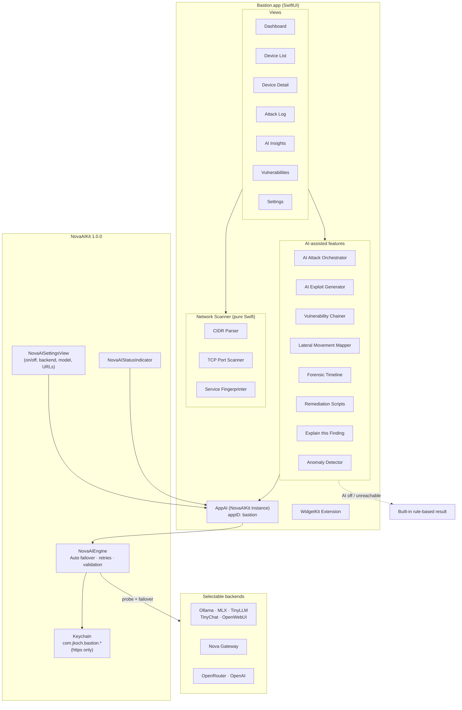

# Bastion


[](LICENSE)


**AI-powered network penetration testing for macOS.** Bastion combines pure-Swift network scanning with a single, consistent AI layer to discover devices, identify vulnerabilities, chain exploits, map lateral movement paths, and generate professional security reports — all from a native SwiftUI application on Apple Silicon.

As of **v1.1.0**, all AI in Bastion runs through **[NovaAIKit](https://github.com/kochj23/NovaAIKit) 1.0.0** — the shared AI layer used across Jordan Koch's macOS apps. One settings panel, one status indicator, one Keychain convention, eight selectable backends, automatic failover, and a built-in fallback for every feature. **AI is always optional:** with it turned off, every feature still produces a deterministic, rule-based result and nothing leaves the Mac.

Written by Jordan Koch ([@kochj23](https://github.com/kochj23)).

---

## Architecture



Every AI feature calls the one `AppAI.shared` object. The engine probes the configured backends, fails over in priority order, retries on transient failure, and validates output; if AI is off or nothing is reachable, the feature's built-in fallback runs instead. The old per-app `AIBackendManager`, `LLMLoadBalancer`, `EthicalAIGuardian`, and `UnifiedAICapabilities` stacks were removed in v1.1.0.

---

## AI (NovaAIKit)

Bastion's AI is configured in one place — **Settings → AI** (`NovaAISettingsView`) — and its reachability is shown by a status dot (`NovaAIStatusIndicator`) in the AI Insights header.

| | |
|---|---|
| **On/off** | A single toggle. Off → every feature uses its built-in result; nothing is sent anywhere. |
| **Backends** | Auto, Ollama, MLX, TinyLLM, TinyChat, OpenWebUI, Nova Gateway, OpenRouter, OpenAI. |
| **Auto failover** | Probes backends in priority order (Ollama first), picks the first reachable, retries with timeouts. |
| **Model picker** | Per-backend model selection with live model listing where the backend supports it. |
| **Editable URLs** | Each backend's endpoint is editable and validated (max length, scheme). |
| **Keys** | API keys (OpenRouter, OpenAI, OpenWebUI) live **only in the macOS Keychain** under `com.jkoch.bastion.<backend>`, **https only** — never in UserDefaults, files, or the environment. A key never appears as plaintext in the UI. |
| **Validation** | Output is validated per feature; invalid replies are rejected and retried once, then fall back. |

### Fallback behaviour per feature

| Feature | When AI is on | When AI is off / unreachable |
|---|---|---|
| AI Attack Orchestrator | Ranks targets, predicts chains | Skips AI enrichment; rule-based scan/scoring stands |
| AI Exploit Generator | Generates PoC code from CVEs | Returns no AI suggestion; manual flow unaffected |
| Vulnerability Chainer | AI-discovered chains added | Heuristic chains only (SQLi→RCE, traversal→creds, …) |
| Lateral Movement Mapper | AI-enhanced pivot analysis | Trust-relationship heuristics only |
| Forensic Timeline | AI narrative summary | Deterministic basic narrative |
| Remediation Scripts | AI recommendations appended | Rule-based hardening scripts only |
| Explain this Finding | Plain-English summary | Disabled with a clear reason; core security unaffected |
| Executive summary (Dashboard) | CISO-style summary | "Network assessment complete." template |

### Explain this finding

Every security finding has an **Explain** action. The prompt is built by a pure, network-free `FindingExplainer.explainPrompt(for:)` (fully unit-tested), and **secret-like content — passwords, API keys, tokens, bearer/basic auth, HTTP basic-auth in URLs, AWS access-key ids, PEM private-key blocks — is redacted before anything reaches a backend.** When no backend is reachable the action is disabled with a clear reason and never blocks Bastion's core functions.

> **Dropped in v1.1.0:** the Google Cloud, Azure, AWS, and IBM Watson backends are no longer part of Bastion — NovaAIKit does not include them. Any secrets those backends stored are scrubbed from the Keychain on first launch.

---

## Features

### Network Reconnaissance

| Capability | Detail |
|---|---|
| Host Discovery | CIDR-based scanning (/24 and /16) with concurrent TCP connect probes |
| Port Scanning | 23 common ports (FTP, SSH, Telnet, HTTP, HTTPS, SMB, RDP, databases) |
| Service Fingerprinting | Banner grabbing and version detection via raw TCP connections |
| OS Detection | Heuristic identification based on exposed service combinations |
| Quick Scan | Fast top-10-port sweep mode |
| DNS Resolution | Reverse DNS hostname lookup |

Built on Darwin BSD sockets and the Network framework (`NWConnection`) — no dependency on nmap or external tools.

### AI-Assisted Attack Orchestration

- **AI Attack Orchestrator** — Analyzes the threat landscape, ranks targets by exploitability, predicts success probabilities, and identifies multi-step attack chains.
- **AI Exploit Generator** — Reads CVE descriptions and produces proof-of-concept exploit code (Python, Bash, Ruby) tailored to target and vulnerability.
- **Vulnerability Chainer** — Identifies multi-step paths: info-disclosure→priv-esc, SQLi→RCE, path-traversal→credential-theft, XSS→admin-takeover, exploit→persistence.
- **Lateral Movement Mapper** — Discovers trust relationships (SSH key reuse, shared credentials, flat segmentation) and builds single- and multi-hop pivot paths.

### Post-Compromise Assessment (10 Phases)

Connects to a target over SSH and performs deep forensic inspection:

| Phase | Module | What It Detects |
|---|---|---|
| 1 | Rootkit Detector | Kernel and userland rootkits |
| 2 | Suspicious User Detector | UID-0 accounts, empty passwords, anomalous shells |
| 3 | Backdoor Detector | Unauthorized listening ports and services |
| 4 | Hidden Process Detector | Processes hidden from `ps` / `/proc` |
| 5 | Binary Integrity Checker | Modified system binaries |
| 6 | Persistence Detector | Cron jobs, init scripts, authorized_keys |
| 7 | Kernel Module Analyzer | Suspicious or unsigned kernel modules |
| 8 | Log Tampering Detector | Cleared logs, timestamp gaps, truncated files |
| 9 | Network Sniffer Detector | Promiscuous interfaces and packet-capture tools |
| 10 | AI Analysis | Natural-language forensic summary (built-in narrative when AI is off) |

### CVE Database and MITRE ATT&CK

- Downloads and caches critical/high-severity CVEs from NIST NVD
- Maps services to known vulnerabilities with CVSS scores
- All findings mapped to MITRE ATT&CK techniques and tactics, with exportable Navigator JSON
- Covers all 14 ATT&CK tactics from Reconnaissance through Impact

### Continuous Monitoring and Anomaly Detection

- Scheduled scans at configurable intervals with baseline diffing
- CoreML-based anomaly detector learns normal device behavior and flags deviations (AI enrichment optional)
- macOS notifications for security alerts, full scan history with timeline tracking

### Reporting and Remediation

- **PDF reports** via PDFKit: title page, executive summary, network overview, per-device detail, AI analysis
- **Remediation scripts** — per-device hardening bash covering SSH, web, SMB, and DNS
- **Forensic timeline** — rebuilds attacker activity from post-compromise evidence with an AI-generated (or built-in) narrative

### Exploit Modules

| Module | Protocol / Target |
|---|---|
| SSHModule | SSH brute force, key auth |
| SMBModule | SMB/CIFS, EternalBlue |
| DNSModule | DNS zone transfer, cache poisoning |
| LDAPModule | LDAP enumeration, anonymous binds |
| WebModule | HTTP/HTTPS, SQLi, XSS, path traversal |
| DefaultCredsModule | Common default credentials |

### WidgetKit Extension

Small, medium, and large widgets showing security score, vulnerability breakdown, devices at risk, and last scan time. Auto-syncs via App Group `group.com.jkoch.bastion`.

---

## Responsible Use

Bastion is for **authorized security testing**, penetration-testing engagements, CTF competitions, and education. Scanning is restricted to RFC 1918 local IP addresses (192.168.x.x, 10.x.x.x, 172.16–31.x.x), and a legal warning with explicit acknowledgment is required at every launch.

Unauthorized access to computer systems is illegal under the Computer Fraud and Abuse Act (CFAA), the Computer Misuse Act, and equivalent legislation. Always obtain written authorization before testing.

---

## Requirements

- **macOS 13.0 (Ventura)** or later
- **Apple Silicon** (arm64) — bundles MLX for on-device inference
- **Xcode 16+** to build from source

---

## Installation

Bastion is distributed as a DMG installer; it is not on the Mac App Store.

1. Download the latest `.dmg` from [Releases](https://github.com/kochj23/Bastion/releases).
2. Open it and drag **Bastion** into **Applications**.
3. Launch it from Applications.

> **"Bastion can't be opened because the developer cannot be verified"?** This build is ad-hoc signed for local use.
> - **macOS 14 and earlier:** Control-click the app → **Open** → **Open**.
> - **macOS 15/26+:** double-click, dismiss the dialog, then **System Settings → Privacy & Security → Open Anyway**.
> - Or: `xattr -dr com.apple.quarantine "/Applications/Bastion.app"`

### From Source

Building compiles Metal GPU shaders for the `mlx-swift` dependency, which needs Apple's Metal Toolchain:

```bash
xcodebuild -downloadComponent MetalToolchain     # once
git clone git@github.com:kochj23/Bastion.git
cd Bastion
xcodebuild -project Bastion.xcodeproj -scheme Bastion -configuration Release build
```

App sandbox is disabled for network scanning, SSH connections, and raw socket access.

### Optional local AI setup

```bash
brew install ollama && ollama serve && ollama pull mistral:latest
```

---

## Testing

232 tests across 12 test classes, all passing. The NovaAIKit adoption contract is covered by **`AIKitAdoptionTests`** (15 tests) spanning all seven categories:

| Category | What it checks |
|---|---|
| Security | Keychain service names `com.jkoch.bastion.*`, https-only keys, finding redaction |
| Performance | Offline fallback returns without hanging |
| Retry | Validator rejection falls back cleanly |
| Unit | Backend roster (9 cases), `nonEmpty` validator |
| Integration | Legacy `AIBackendManager_*` settings migrate; `AppAI.migrateLegacy` is safe |
| Functional | AI off → built-in result; Explain disabled when unreachable |
| Frame / UI-state | Status is `.off` when disabled; status-indicator colour mapping |

```bash
xcodebuild test -project Bastion.xcodeproj -scheme Bastion \
  -configuration Debug -destination 'platform=macOS' -only-testing BastionTests
```

---

## Technical Details

- **Language:** Swift 5.9, SwiftUI
- **Minimum OS:** macOS 13.0; test target macOS 14.0
- **AI layer:** [NovaAIKit](https://github.com/kochj23/NovaAIKit) 1.0.0 (SwiftPM, `from: 1.0.0`)
- **Keychain:** `com.jkoch.bastion.<backend>`, account `apiKey`, https only
- **App Group:** `group.com.jkoch.bastion` (shared with the WidgetKit extension)
- **Network layer:** Darwin BSD sockets via `Network` (`NWConnection`); no external tool dependencies
- **CVE data:** cached in `~/Library/Application Support/Bastion/CVE/`
- **Concurrency:** Swift structured concurrency (`async`/`await`, `TaskGroup`) throughout

---

## Changelog

See [CHANGELOG.md](./CHANGELOG.md). Latest: **v1.1.0 — migrated all AI to NovaAIKit 1.0.0**; removed the in-app AI client stack and the Google/Azure/AWS/IBM backends; one settings panel, status indicator, and Keychain convention across the app.

---

## More Apps by Jordan Koch

| App | Description |
|---|---|
| [NMAPScanner](https://github.com/kochj23/NMAPScanner) | Network security scanner with AI threat detection |
| [MLXCode](https://github.com/kochj23/MLXCode) | Local AI coding assistant for Apple Silicon |
| [URL-Analysis](https://github.com/kochj23/URL-Analysis) | Network traffic analysis and URL monitoring |
| [RsyncGUI](https://github.com/kochj23/RsyncGUI) | Native rsync front-end with AI assistance |

[View all projects](https://github.com/kochj23?tab=repositories)

---

## License

MIT License — see [LICENSE](./LICENSE). Ethical usage required — see [ETHICAL_AI_TERMS_OF_SERVICE.md](./ETHICAL_AI_TERMS_OF_SERVICE.md).

Copyright (c) 2026 Jordan Koch.

Written by Jordan Koch ([@kochj23](https://github.com/kochj23)).
